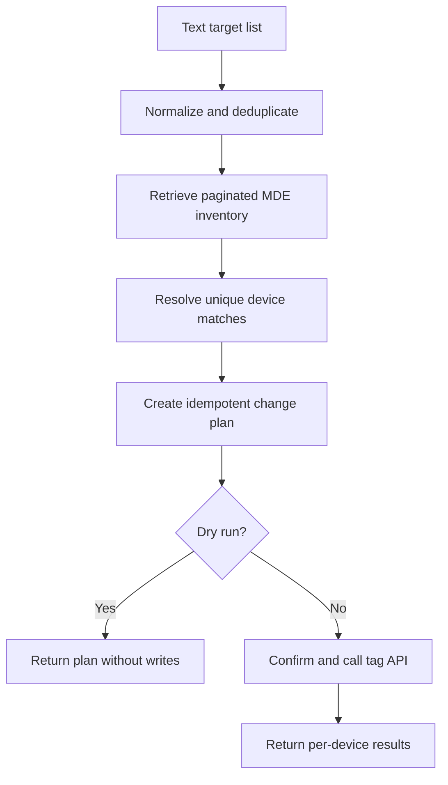

# MDE Device Tagging Tool

[](https://learn.microsoft.com/powershell/)
[](https://github.com/Dante404/mde-device-tagging-tool/actions/workflows/powershell-quality.yml)
[](./LICENSE)

A safety-first PowerShell tool for adding or removing Microsoft Defender for Endpoint
machine tags from a text list of hostnames.

> This repository is a clean-room portfolio implementation. It contains no employer source
> code, production identifiers, tenant data, access tokens, onboarding packages, or customer
> information. All included names and results are synthetic.

## Why this project exists

Tagging a few devices manually is simple. Performing the same task across hundreds or
thousands of endpoints requires safeguards for pagination, ambiguous hostnames, retries,
API limits, partial failures, and accidental writes.

This project demonstrates those engineering concerns with a deliberately conservative
default: **running the script without `-DryRun:$false` cannot change a tag**.

## Features

- Delegated OAuth 2.0 device-code authentication with no stored refresh token
- No client secret or user password stored by the script
- Complete machine inventory retrieval using OData `$top` and `$skip` pagination
- Short-hostname and FQDN matching with an optional domain suffix
- Safe handling of duplicate Defender device records
- Idempotent behavior: existing tags are not added twice and absent tags are not removed
- Dry-run mode enabled by default
- A second live-change gate through PowerShell `ShouldProcess`
- Bounded retries with exponential backoff and `Retry-After` support
- Configurable pacing between writes to respect service limits
- Per-device results suitable for CSV export and audit review
- Pester tests and a PowerShell quality workflow

## Flow



## Prerequisites

- PowerShell 7.2 or later
- A Microsoft Entra public-client application registration
- Delegated Defender for Endpoint permission `Machine.ReadWrite`
- A signed-in user with the Defender **Manage security settings** permission and access to
  the relevant device groups

Microsoft documents the API and permission requirements here:

- [Use Microsoft Defender for Endpoint APIs](https://learn.microsoft.com/defender-endpoint/api/exposed-apis-create-app-nativeapp)
- [OAuth 2.0 device authorization grant](https://learn.microsoft.com/entra/identity-platform/v2-oauth2-device-code)
- [List machines API](https://learn.microsoft.com/defender-endpoint/api/get-machines)
- [Add or remove a machine tag](https://learn.microsoft.com/defender-endpoint/api/add-or-remove-machine-tags)

The API calls use `https://api.security.microsoft.com`, while token acquisition defaults to
the legacy Defender resource scope `https://api.securitycenter.microsoft.com/.default` for
compatibility with Defender APIs that still require that token audience.

## Entra application setup

1. Register a single-tenant application in Microsoft Entra ID.
2. Under **Authentication**, enable **Allow public client flows** for device-code sign-in.
3. Under **APIs my organization uses**, find `WindowsDefenderATP`.
4. Add the delegated `Machine.ReadWrite` permission.
5. Grant the required consent according to your organization's process.
6. Record the tenant ID and application/client ID. Do not store a token or client secret in
   this repository.

## Input format

Create a UTF-8 text file with one hostname per line. Blank lines and comments beginning with
`#` are ignored, and duplicate names are removed case-insensitively.

```text
# Short names and FQDNs are supported.
win-client-001
linux-server-002.lab.example
win-server-003
```

See [`examples/devices.txt`](./examples/devices.txt).

## Usage

### Preview an addition—the default

```powershell
./src/Invoke-MdeDeviceTagging.ps1 `
    -TenantId '<tenant-id>' `
    -ClientId '<application-client-id>' `
    -InputPath './examples/devices.txt' `
    -Tag 'Migration-Pilot' `
    -Action Add
```

This returns `DryRun` results and performs no tag writes.

### Apply the reviewed plan

```powershell
./src/Invoke-MdeDeviceTagging.ps1 `
    -TenantId '<tenant-id>' `
    -ClientId '<application-client-id>' `
    -InputPath './examples/devices.txt' `
    -Tag 'Migration-Pilot' `
    -Action Add `
    -DryRun:$false `
    -OutputPath './tagging-results-20260908.csv'
```

PowerShell requests confirmation through `ShouldProcess` before live writes. Use `-WhatIf`
as an additional native PowerShell simulation control.

### Restrict short-name matching to a domain

```powershell
./src/Invoke-MdeDeviceTagging.ps1 `
    -TenantId '<tenant-id>' `
    -ClientId '<application-client-id>' `
    -InputPath './examples/devices.txt' `
    -Tag 'Migration-Pilot' `
    -Action Add `
    -DomainSuffix 'lab.example'
```

### Handle duplicate Defender records deliberately

By default, multiple matches are reported as `Ambiguous` and skipped. After reviewing why
duplicates exist, `-SelectNewestMatch` can select the record with the newest `lastSeen` value.

### Remove a tag

Use `-Action Remove`. Dry-run and confirmation behavior remain unchanged.

## Result statuses

| Status | Meaning |
|---|---|
| `DryRun` | A change is required, but no write was attempted |
| `NoChange` | The desired tag state already exists |
| `NotFound` | No accessible Defender record matched the target |
| `Ambiguous` | Multiple records matched and safe resolution was not requested |
| `Skipped` | `ShouldProcess` did not approve the live change |
| `Succeeded` | The tag API returned successfully |
| `Failed` | The API write failed after the configured retry policy |

A fully synthetic result file is available at
[`examples/sample-dry-run.csv`](./examples/sample-dry-run.csv).

## Scale and rate limits

The list-machines API currently allows pages of up to 10,000 records. This implementation
uses a configurable page size and continues until the entire accessible inventory has been
retrieved, rather than assuming the first 500 devices are sufficient.

Tag changes are individual API calls. Microsoft currently documents limits of 100 calls per
minute and 1,500 calls per hour for the tag operation. The default three-second delay keeps a
sustained run below the hourly limit, while HTTP 429 and transient server responses are retried.

## Tests

```powershell
Install-Module Pester -MinimumVersion 5.5.0 -Scope CurrentUser
Invoke-Pester -Path ./tests -Output Detailed
```

The tests use mocked API responses. They do not require a tenant or make network requests.

## Security considerations

- Treat exported machine IDs and results as organizational data.
- Do not pass tokens in source files, command history, CI variables, or screenshots.
- Use delegated permissions and Defender device-group scoping to limit accessible devices.
- Review ambiguous and not-found results before enabling live mode.
- The tool does not bypass Defender RBAC, Conditional Access, or Entra consent controls.

See [`docs/design-decisions.md`](./docs/design-decisions.md) for the implementation rationale.

## License

MIT. See [`LICENSE`](./LICENSE).
